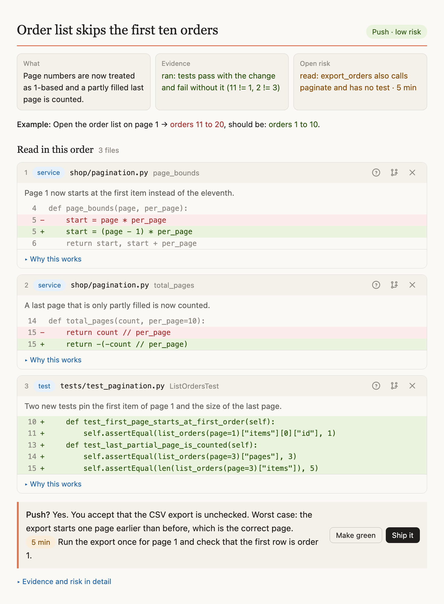
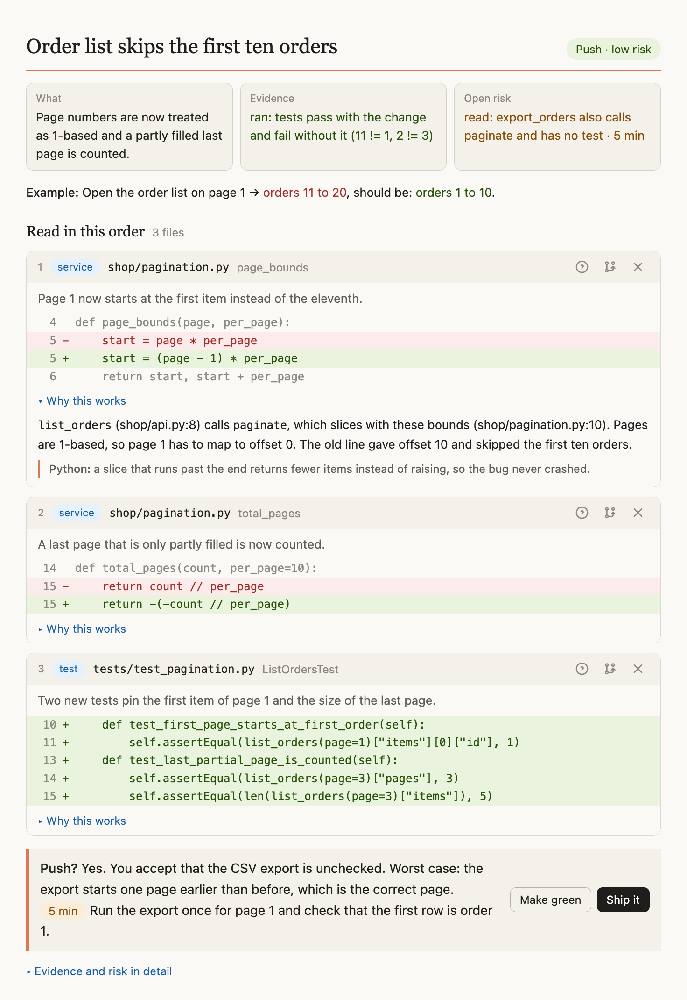
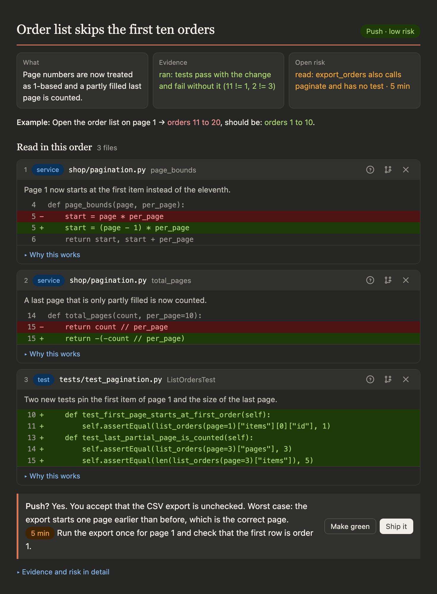

# Agentcheck

Know why a change works before you push it. One report, one minute, with proof.



Agentcheck is a Claude Code skill for the moment between "the test is green" and
`git push`. It works on any codebase and language, for bug fixes and features.

## Why

Agents write code faster than people can read it. The test goes green, the diff
is two hundred lines, and you push something you could not explain if someone
asked. A green test only shows that the code works now. It does not show that
this change is the reason, or which parts of the diff you could have left out.

Agentcheck ties every hunk to a step in the cause of the bug, runs your test
with the change and again without it, and tells you what is proven and what is
not.

## What you get

- **A one-minute report.** What changed, the strongest evidence, the one risk
  that is still open, and a push decision.
- **The files in reading order.** Data layer first, each with its diff and a
  plain "why this works" that names the caller.
- **A proof by revert.** Your test passes with the change and fails without it,
  run in a scratch worktree. Your working tree is never touched.
- **Honest tags.** Every claim is marked `ran`, `read` or `assumed`.
- **Follow-up buttons.** Ask for more depth on one file, drop a hunk, or check
  whether you can ship without it.

Nothing is committed or pushed unless you approve it.

## Install

As a plugin, in Claude Code:

```
/plugin marketplace add <owner>/agentcheck
/plugin install agentcheck@agentcheck
```

Or from your shell:

```bash
claude plugin marketplace add <owner>/agentcheck
claude plugin install agentcheck@agentcheck
```

The skill is then available as `/agentcheck:agentcheck`, and Claude picks it up
by itself when you ask one of the questions below.

<details>
<summary>Manual copy</summary>

```bash
git clone https://github.com/<owner>/agentcheck.git
mkdir -p ~/.claude/skills
cp -R agentcheck/skills/agentcheck ~/.claude/skills/
```

The skill is then available as `/agentcheck`. Pick one install method. With
both you get the skill twice.

</details>

## Usage

Make your change, run your test, then ask:

- "should I push this?"
- "why does this fix work?"
- "explain this change before I open the PR"
- "is this safe to merge?"
- "can I ship without the refactor in utils.py?"
- "I don't understand this diff"

For a feature, say "explain this change". The report then shows the goal instead
of the problem, and before and now instead of wrong and right.

The report is written in the language you write in. Three worked examples are in
[docs/EXAMPLES.md](docs/EXAMPLES.md).

## What's in the report



The layout is always the same, so you learn where to look.

| Part | What it tells you |
|---|---|
| Title and verdict | The bug or feature in plain words, and a pill: push, push after X, or do not push |
| What, Evidence, Open risk | The change in one sentence, the strongest evidence with its tag, the one unproven thing and the minutes it takes to check |
| Example | One line: action, what it gave, what it should be |
| Read in this order | Up to four file cards in dependency order, with a few diff lines and a closed "Why this works" |
| Push? | The decision, the risk you accept, the worst case, and the steps to make it green |
| Evidence and risk in detail | A closed dropdown with every claim and its tag, a risk pill per card, and the hunks that do not belong in this commit |

A small change (one file, under about 20 changed lines) gets a short report with
one card. The report also works in dark mode, and
[docs/example-report.html](docs/example-report.html) is the example above as a
standalone page.



## Follow-up buttons

Each file card has three icon buttons, and the push block has two buttons. They
send a chat message for you. You get an answer in the chat, not a new report.

| Button | What happens |
|---|---|
| Explain better | A deeper explanation of that one card: callers, data flow, a tiny before and after |
| Ship without it? | Checks whether the rest of the change still fixes the bug without that card. Yes or no, with a tag. No edits |
| Drop this change | Shows the exact hunks that would be reverted and what depends on them. Reverts only after you say yes |
| Make green | Does the open steps: runs the test, proposes a small test, or gives you the manual steps |
| Ship it | Lists what would be committed and asks the ship question below |

Without a widget tool the report is markdown and ends with the same commands to
type: `explain 1 · drop 2 · ship without 2 · make green · ship`.

## The ship question

After the report Claude asks one question, "Ship this change?", with three
choices:

- **Approve.** Does what your ship preference says (see below).
- **Decline.** You type what should be different. Claude makes only that change
  and runs the report again.
- **Leave as is.** Nothing happens.

When the verdict is "do not push", Decline comes first and Approve is labelled
"Approve anyway".

The ship preference lives in `~/.claude/agentcheck.json`:

```json
{"ship": "commands"}
```

| Value | Approve does |
|---|---|
| `commands` (default) | Prints the exact git commands and does nothing |
| `commit` | Commits with a short message |
| `push` | Commits and pushes the branch |

Say "agentcheck always push" (or commit, or commands) and Claude writes the
file for you. If your `CLAUDE.md` says never commit or push, the skill prints
the commands whatever the file says. Commits never get an AI attribution line.

## How the proof by revert works

1. A scratch git worktree is created under `$TMPDIR`. Your working tree and
   index are not modified.
2. Your change is applied there and the test command runs. It has to pass.
3. The worktree is reset to the base and the same command runs again. It has to
   fail, and the failure has to be the bug you reported.
4. The worktree is removed.

Passes both ways means unproven: the change does nothing, or the test does not
cover it. Fails with the change means something is broken. No test at all means
no proof, and the report proposes the smallest test that would do.

```bash
skills/agentcheck/scripts/revert-proof.sh [--keep PATH] [--link DIR] '<test command>' [base-ref]
```

`--keep` holds a path in both runs (use it for a test that is new in this
change). `--link` symlinks an ignored directory such as `node_modules` into the
worktree. Run `revert-proof.sh --help` for all options and exit codes.

## Token cost

The skill is built to stay cheap.

| Loaded | Size | When |
|---|---|---|
| `SKILL.md` | 4.7 KB, about 1.2k tokens | Every run |
| `references/revert-proof.md` | 3.1 KB | When the proof runs |
| `references/report.md` and the template | 5.2 KB and 4.8 KB | When the report is rendered |
| `references/followups.md` | 1.4 KB | Only after you click a button |
| `references/report-markdown.md` | 1.3 KB | Only without a widget tool |

A full run reads about 18 KB of instructions, roughly 4.5k tokens. On top of that:

- `collect-diff.sh` prints the status, the diff stat and the names of untracked
  files first. The diff is then read per file with `--diff <paths>` (capped at
  400 lines) and a new file with `--show <file>` (capped at 4 KB). Binary files
  are never printed.
- Code is read with grep and line ranges, not whole files.
- The report has at most four cards with about six diff rows each.

## Requirements

- Claude Code.
- A git repository. The change can be uncommitted or on a branch.
- bash 3.2 or newer (the default on macOS works) and git with worktree support.
- A test or repro command for the proof by revert.
- Optional: a widget tool that renders HTML in the chat, such as
  `mcp__visualize__show_widget` in the Claude desktop app. Without it you get the
  same sections as compact markdown.

## Limits

- A proof by revert shows that this change makes this test pass. It does not
  show that the change is complete or that nothing else broke.
- The proof is only as good as the test. A test written after the change to fit
  it is weaker than one that existed before.
- The scratch worktree has no ignored files (dependencies, env files, build
  output). You can link dependency directories in with `--link`, but symlinks in
  them that point back into the repo still see the changed code. The script
  warns when it finds those.
- Changes that depend on timing, database state or an external service may not
  reproduce in a test command. The proof is then manual and the report says so.
- It is not a bug hunt, style review or security review. It answers one
  question: why does this change do what it claims, and is that proven.
- Windows needs Git Bash or WSL for the scripts.

## Scripts

Both scripts are read-only on your working tree and can be used on their own.

```bash
skills/agentcheck/scripts/collect-diff.sh [base-ref]                    # status, stat, untracked names
skills/agentcheck/scripts/collect-diff.sh [base-ref] --diff [paths...]  # unified diff, capped
skills/agentcheck/scripts/collect-diff.sh --show <file>                 # one new file, capped
```

The plugin version is set in `.claude-plugin/plugin.json`. Installed copies stay
on that version until it is bumped there.

## License

MIT, see [LICENSE](LICENSE). Copyright (c) 2026 Pepijn Baggen.
